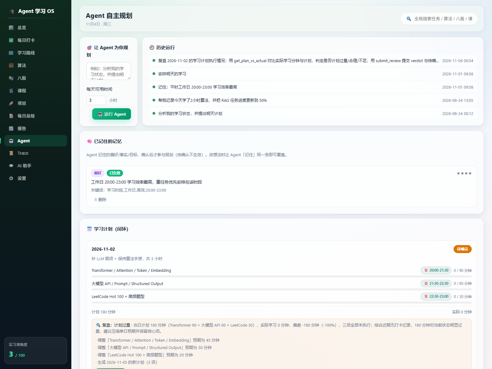
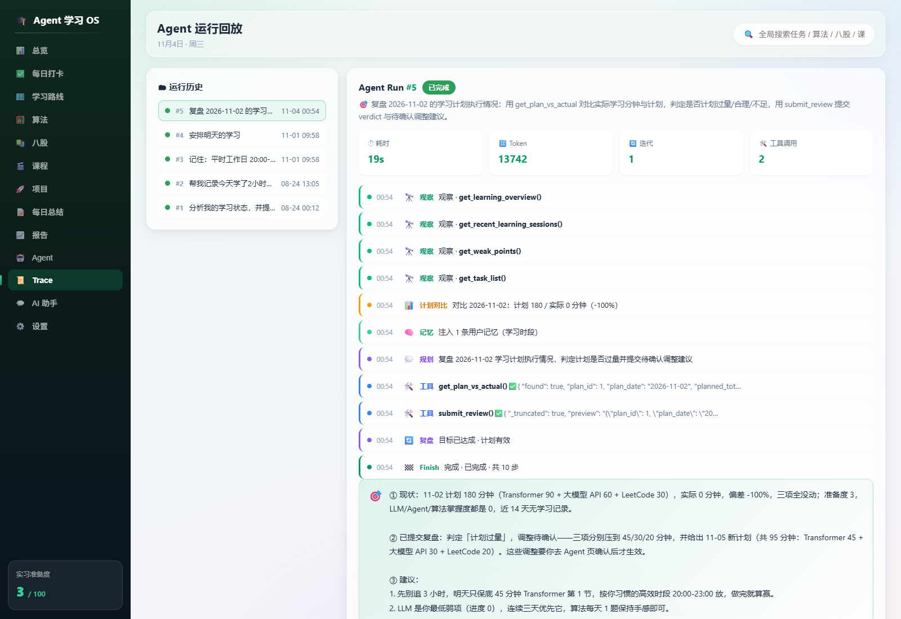
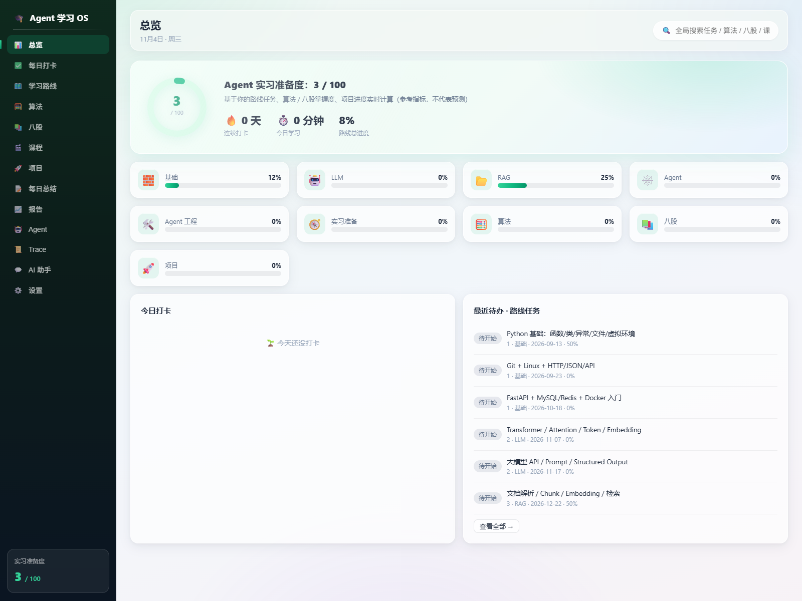
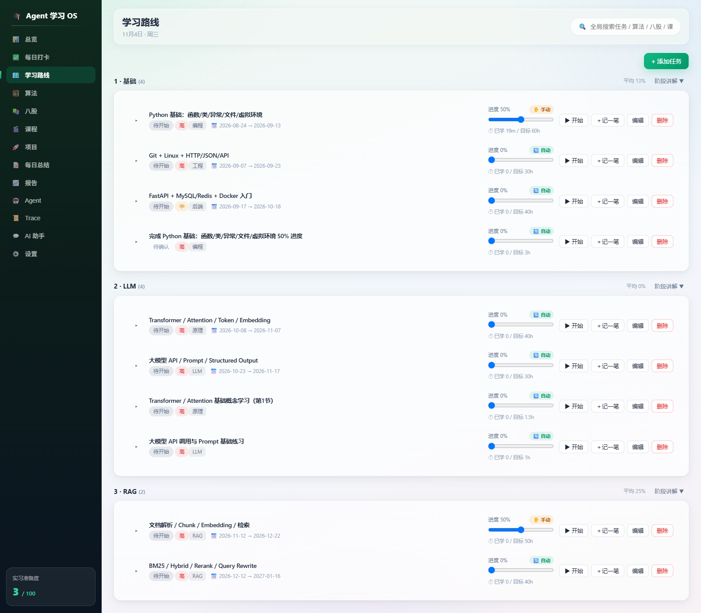

# 🎓 Agent 学习 OS

**一个跑在自己电脑上的自主规划 Agent 系统**：Observe → Plan → Execute → Reflect 闭环，18 个工具读写真实学习数据，每次运行全程留痕可回放。

不是聊天机器人 demo —— 它真的在管理一个学生的课程、任务、学习计划和长期记忆。



---

## 这是什么

我给自己做的一年期学习操作系统。表面是个学习管理 Web 应用（打卡、任务、八股、课程、项目），核心是一个**能自己规划并操作数据的 Agent**：

- 你说「帮我安排明天的学习」，它先观察你的真实数据（任务、最近学习时长、薄弱点），再规划，再调用工具把计划写进数据库
- 每次运行产生 9 类 trace 事件（observe / plan / tool_call / tool_result / plan_compare / user_memories / reflect / replan / finish），在 Trace 页可以完整回放
- 写操作全部有审计，高风险操作（写长期记忆、应用复盘调整）必须你点确认才生效

**为什么做这个**：市面上的 AI 学习工具都在「给建议」，但建议不落地就没人执行。我想验证一件事——**如果 Agent 能直接改我的学习数据，它是不是就真的能替我排计划？** 结论是能，前提是把它的能力边界设计清楚。



---

## 技术亮点

### 1. 确定性核心 + LLM 边缘

观察、执行、留痕全部走确定性代码；只有 Plan / Reflect / Synthesize 三步调 LLM。

```
_seed_observe()      ← 确定性：固定 4 个只读工具取真实数据
  ↓
_inject_prior_plan_vs_actual()   ← 确定性：算上期计划偏差
_inject_memories()               ← 确定性：注入 active 长期记忆
  ↓
for iteration in range(1, MAX_ITERATIONS + 1):
    plan = planner.plan()        ← LLM
    results = executor.run()     ← 确定性：工具执行 + 审计
    reflection = reflector.reflect()  ← LLM
  ↓
synthesize()                     ← LLM
```

**收益**：模型不稳定不会污染数据；每一步的 state 都在库里，出问题能精确定位到是哪个 LLM 步骤错了，而不是"AI 有时候会乱来"。

### 2. 18 个工具的权限分级与审计

9 读 9 写，分三级权限（READ / APPEND / MUTATE）：

| 级别 | 工具数 | 行为 |
|---|---|---|
| 只读 | 9 | 直接返回数据 |
| 直接生效 | 7 | 写入 + 记录 `agent_actions`（before→after 快照，可回滚） |
| **待确认门禁** | 2 | `remember`（长期记忆）、`submit_review`（复盘调整）——Agent 只能提交建议，用户点确认才生效 |

设计原则：**AI 可以建议，但不能替我做决定。** 排学习计划可以自主（错了代价低），改长期记忆和调整计划必须我确认（错了会持续影响后续所有运行）。

### 3. 三层防失控

| 机制 | 实现 | 防什么 |
|---|---|---|
| 迭代硬上限 | `MAX_ITERATIONS = 3` | 循环烧钱 |
| 单运行锁 | 同一时刻只允许一个 run | 并发写坏数据 |
| 取消 + 崩溃恢复 | 取消端点 + 残留 run 标记 | 线程裸崩、UI 白屏 |

run 全程不抛异常：任何内部错误落库为 `status=failed` + error 字段，前端能看到失败原因而不是白屏。

### 4. 放弃 function calling，换取模型无关性

不用 OpenAI 的 `tools` / Anthropic 的 `tool_use`，改用 `response_format=json_object` + 自写 JSON 抽取兜底 + 失败重试 1 次。

- **收益**：同一套 Agent 逻辑跑 DeepSeek / GPT / Claude 三家，换供应商只改配置不改代码
- **代价**：Claude 无 `json_object` 原生模式，走「强提示 + 抽取 + 重试」，偶发「未返回合法 JSON」是已知限制（run 会落 failed 并显示内容预览）

**为什么值得**：这是个单人自用工具，用户会换便宜模型。被一家供应商锁死的成本 > 结构化输出损失的那点稳定性。

### 5. 长期记忆：不为 RAG 而 RAG

记忆是结构化的（mkey 主题 / mtype 类型 / importance 1–5），同主题 upsert 覆盖，注入时只取 `status=active` 且限 20 条防烧 token。

用户的学习偏好只有几十条 —— **向量检索在这个规模上是纯开销**。第一版直接 SQLite，等真的到了需要语义检索的规模再上。

---

## 一次真实的完整闭环（数据库实录）

「安排明天的学习」这次运行：

- Planner 自主把 3 个任务排进 20:00–21:30 / 21:30–22:30 / 22:30–23:00（`suggested_time` 3/3 命中用户偏好时段）
- 注入了 1 条 active 长期记忆（key = 「学习时段」，importance 4）
- 单次消耗 12366 token，运行状态 `succeeded`
- 全部 9 类 trace 事件落库，可在 Trace 页逐帧回放



---

## 工程规模

| 项 | 数字 |
|---|---|
| 代码量 | 后端 67 文件 / 6384 行（生产 4530 + 测试 1854）· 前端 21 文件 / 3582 行 · **合计 9966 行** |
| 单元测试 | **156 个，全部通过**（`Ran 156 tests in 40.139s` / `OK`） |
| 数据库 | 19 张表，schema 迁移机制已到 v8 |
| 工具数 | 18（9 读 / 9 写） |
| 真实运行 | 5 次，全部 `succeeded`，单次 5278–12366 token |

---

## 快速开始

### 方式一：一键启动（推荐）

双击根目录 **`启动.bat`**，脚本自动完成：

1. 检查 Python 3.10+ 和 Node.js 18+
2. 首次运行创建虚拟环境 `.venv` 并安装依赖（fastapi / uvicorn）
3. 首次运行执行 `npm install` 并构建前端
4. 启动后端服务窗口「AgentOS-后端服务」
5. 就绪后自动打开浏览器 → `http://127.0.0.1:8000`

> 再次启动会跳过已完成的安装步骤，秒开。关闭「AgentOS-后端服务」窗口即停止。

### 方式二：手动启动

```bash
# 后端（项目根目录，用根目录 .venv）
.venv\Scripts\python.exe -m uvicorn main:app --app-dir backend --host 127.0.0.1 --port 8000

# 前端开发服务器（frontend 目录下）
npm run dev
```

### 方式三：只跑测试（不需要前端）

```bash
# 项目根目录
set PYTHONIOENCODING=utf-8
.venv\Scripts\python.exe -m unittest discover -s backend\tests
```

---

## AI 配置（可选）

「📈 报告」的 AI 复盘、「💬 AI 助手」、「🤖 Agent」都由 AI 生成。**不配置也能用**：统计、闭环照常跑，AI 文字区会提示未配置。

支持 **DeepSeek / GPT（OpenAI）/ Claude** 三家，全站共用一个全局模型（「⚙️ 设置」页切换）。

配置 3 步（约 3 分钟）：

1. **注册开通**：任选一家 —— [DeepSeek 开放平台](https://platform.deepseek.com) / [OpenAI 平台](https://platform.openai.com) / [Anthropic 控制台](https://console.anthropic.com)
2. **创建 API Key**：在对应控制台创建 key（DeepSeek 是 `sk-...`）
3. **粘贴进应用**：左侧「⚙️ 设置」→ 选供应商 tab → 粘贴 key → 选模型 → 「测试连接」→ 保存

- **Key 只存本机** `backend/config.json`：不进数据库、不会被 `/api/backup` 导出、不上传（除调用对应模型接口本身）
- **切供应商保留各家 key**
- **各家默认模型**：DeepSeek `deepseek-chat` · GPT `gpt-4o-mini` · Claude `claude-sonnet-5`

---

## 数据存储与备份

- **数据库**：`backend/data/agent_study.db`（SQLite 单文件，删掉即回到初始状态，下次启动自动重新播种）
- 换数据库文件：设环境变量 `AGENT_STUDY_DB` 指向新路径
- **备份**：双击 `备份数据库.bat` → `backups/agent_study_时间戳.db`；或访问 `http://127.0.0.1:8000/api/backup` 下载
- **恢复**：把备份文件复制回 `backend/data/agent_study.db` 覆盖

---

## 功能一览

| 模块 | 说明 |
|---|---|
| 🤖 Agent | 自主规划 Agent：Observe→Plan→Execute→Reflect 闭环，18 个工具读写学习数据，全程留痕可审计 |
| 📜 Trace | 每次运行的完整回放时间轴（9 类事件），可截图、可讲解 |
| 📅 学习计划 | Agent 排计划，实际 vs 计划自动对比，复盘调整经确认后生效 |
| 🧠 长期记忆 | Agent 记住你的偏好（如高效时段），记忆写入需确认后生效 |
| 📊 总览 | 实习准备度综合得分（算法 25% + 八股 20% + 任务 40% + 项目 15%）、连续打卡、今日进度 |
| ✅ 每日打卡 | 按「算法 / 八股 / 课程 / 项目 / 阅读」记录分钟数 |
| 🗺️ 学习路线 | 15 个预置任务按 6 个阶段组织（基础 / LLM / RAG / Agent / Agent 工程 / 实习准备） |
| 🧮 算法 | 题目增删改查、分类筛选、掌握度标记、随机抽题、一键 +复习 |
| 📚 八股 | 15 个预置面试问题（附答案要点）、掌握度标记、随机抽题 |
| 🎬 课程 | 课程卡片（全部经 B站官方 API 核验）、学习进度、一键 +30 分钟 |
| 🚀 项目 | 3 个预置项目（带 7 个里程碑）、进度追踪 |
| 📝 每日总结 | 手写每日总结，按日期查看历史 |
| 📈 报告 | 全年学习热力图 + 周报/月报 + AI 复盘 |
| 💬 AI 助手 | 聊天窗口，AI 自动读学习数据，问进度 / 要建议 / 复盘 |
| 🔍 全局搜索 | 一次搜索任务 / 算法 / 八股 / 课程 / 项目 |
| ⚙️ 设置 | 全局模型供应商 + API key + 测试连接 + 🔌 关闭服务 |



---

## 技术栈

- **后端**：Python 3.10+ · FastAPI · uvicorn · SQLite（标准库）
- **AI**：多模型统一入口（DeepSeek / GPT / Claude），Provider 抽象 + 结构化输出
- **Agent**：自研最小 Agent 运行时（186 行），18 工具 + 全程审计留痕
- **前端**：Node 18+ · React 19 · Vite 6（构建后由后端静态托管，单进程运行）
- **零外部服务**：不依赖云端，数据不上传（AI 调用除外）

```
Agent学习OS_Web版/
├── 启动.bat                  # 一键启动（主入口）
├── 启动-开发模式.bat          # 开发模式（热更新）
├── 备份数据库.bat             # 一键备份
├── 重新构建前端.bat           # 改前端后重建
├── docs/screenshots/         # 界面截图
├── backend/
│   ├── main.py               # FastAPI 入口：建库+播种+托管前端
│   ├── data/                 # 数据库（agent_study.db）
│   └── app/
│       ├── db.py             # 建表 + 迁移机制（当前 v8）
│       ├── stats.py          # 准备度 / 连续天数 / 热力图 / 周月报聚合
│       ├── llm.py            # 多模型统一入口
│       ├── services/         # 业务层：tasks / plans / memories
│       ├── agent/            # Agent 运行时（planner/executor/reflector/runtime/registry + 18 工具）
│       └── routers/          # 各模块 API
├── frontend/
│   └── src/                  # React 源码（14 个页面 + 设计系统）
└── tools/                    # 启动器、图标生成等辅助脚本
```

---

## 已知限制（如实记录）

- **只有一个真实用户：我自己。** 没有用户量、没有并发设计，目标就是单人单机自用
- **Claude 分支**结构化输出走提示词 + 抽取兜底，偶发「未返回合法 JSON」为已知限制
- **仍在规划中（未实现）**：间隔复习、推荐任务、导入导出、AI 流式输出；二期计划 MCP / RAG / 向量库 / LangGraph
- AI 复盘 / 助手 / Agent 未配 key 时自动降级为「仅统计数据 / 提示未配置」，不会崩
- 中文 Windows 下 `.bat` 按 GBK 编码保存，请勿改成 UTF-8

---

## 开发过程中踩过的坑（记录）

**「模型把 task_id 填进 item_id」**：复盘闭环上线后，Agent 提交的调整建议总是应用失败。查下来是 Planner 生成调整项时，把「任务 id」填到了「计划项 id」字段里——因为提示词里这两个概念都用「id」描述，模型分不清。

修法不是加更多提示词，而是在 schema 层做区分：`task_id` 和 `item_id` 分别加类型校验，并在 `_compact_plan` 快照里显式带上两个字段，让人能一眼看出错在哪。

**教训：LLM 的输出不可信，能用代码约束的绝不靠提示词。**

---

Made with ❤️
